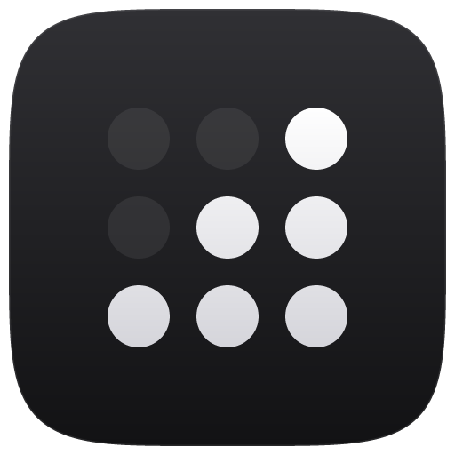
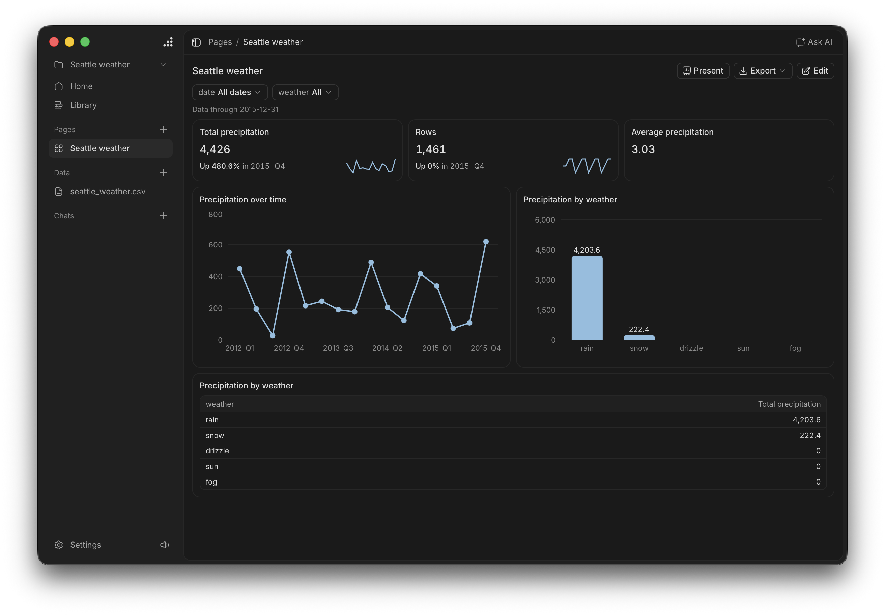

<p align="center">
  
</p>

<h1 align="center">Davis</h1>

<p align="center">
  Explore your data, ask an AI about it, and build dashboards, all on your own computer.
</p>

<p align="center">
  <a href="https://github.com/opikdev/davis/releases/latest"></a>
  <a href="https://github.com/opikdev/davis/actions/workflows/check.yml"></a>
  <a href="LICENSE"></a>
</p>

<p align="center">
  <a href="https://github.com/opikdev/davis/releases/latest"><b>Download</b></a> ·
  <a href="docs/install.md">Install guide</a> ·
  <a href="docs/privacy.md">Privacy</a>
</p>

<p align="center">
  
</p>

Davis is a free, open source desktop app for macOS, Windows, and Linux. It's built around three things:

- **Data.** Open Excel, CSV, Parquet, and JSON files, or read Postgres and MySQL tables live. Each file gets a table, a short brief, and stats for every column.
- **Chat.** Ask questions in plain words. The AI queries your data, then answers with numbers and charts, and shows each query it ran.
- **Pages.** Build dashboards from starting points, simple choices, or by asking the AI. Click a chart to filter the rest. Present a Page full screen, or export it as PDF or PNG.

The **Library** has real public datasets, such as world development figures, CO₂ emissions, flights, and earthquakes, so you can try Davis without your own data. Davis downloads each one straight from its publisher.

## Install

Download the installer for your system from the [latest release](https://github.com/opikdev/davis/releases/latest):

| System | Download |
|---|---|
| macOS, Apple silicon and Intel | `.dmg` |
| Windows 10 and 11 | `-setup.exe` or `.msi` |
| Linux | `.deb`, `.rpm`, or `.AppImage` |

Davis isn't code signed yet, so macOS and Windows warn you the first time you open it. [Install Davis](docs/install.md) shows how to get past that.

## Your data stays yours

- **No account, analytics, or tracking.** Davis never sends anything to the people who make it.
- **Projects are normal folders**, in `Documents/Davis` by default. Davis copies your files into the project, so you can move or back it up like any other folder.
- **The AI never reads your files.** It can only ask Davis to run read-only queries, and it sees at most 50 rows of each result.
- **Databases are read only.** Davis reads them live and never copies them into the project. Passwords stay in your system keychain.

See the [privacy policy](docs/privacy.md) for exactly what goes where.

## Choose your AI

Davis works with the AI you already use, or none at all. Files, Pages, and the Library work without one.

| Connect | Examples |
|---|---|
| AI tools you're signed in to | Claude Code, Codex, OpenCode |
| API keys | Anthropic, OpenAI, Google Gemini, Mistral, DeepSeek, and more |
| Local models that run on your computer | Ollama, LM Studio, llama.cpp |
| Gateways | OpenRouter, LiteLLM, Vercel AI Gateway, or any custom URL |

Claude Code and API keys get the full analyst. Codex and OpenCode run with their tools off and answer one query at a time. Connecting AI tools has only been tried on macOS so far.

## Build from source

Install [the Tauri prerequisites](https://v2.tauri.app/start/prerequisites/), [rustup](https://rustup.rs/), Node.js, and pnpm, then run:

```sh
pnpm install
pnpm tauri dev
```

`rust-toolchain.toml` installs the pinned Rust version on first use. The first build compiles DuckDB from source and takes a few minutes.

| Command | What it does |
|---|---|
| `pnpm check` | Type checks, lint, and tests for TypeScript and Rust |
| `pnpm tauri build` | Builds the installer for your system |

CI also opens the built app on Windows and Linux and runs the tests in `e2e/`. There's no WebDriver for the macOS web view, so check Mac changes by hand.

Davis is built with [Tauri](https://tauri.app/), [React](https://react.dev/), [shadcn/ui](https://ui.shadcn.com/) on [Base UI](https://base-ui.com/), and [DuckDB](https://duckdb.org/), which runs every query.

## Docs

| For | Read |
|---|---|
| People using Davis | [Install Davis](docs/install.md), [Connect a database](docs/connect-a-database.md), [Privacy policy](docs/privacy.md) |
| Contributors | [Architecture](docs/architecture.md), [Add a backend command](docs/add-a-backend-command.md), [Add an AI provider](docs/add-an-ai-provider.md), [Add a dataset to the Library](docs/add-a-dataset.md) |
| Maintainers | [Release Davis](docs/release.md), [Code signing policy](docs/code-signing.md), [ADR 001: Use Tauri with a separate Rust core](docs/decisions/001-tauri-with-rust-core.md) |

## Contribute

Issues and pull requests are welcome. Read [Contributing](CONTRIBUTING.md) first, and report security problems as [Security](SECURITY.md) describes.

## License

[Apache-2.0](LICENSE)
