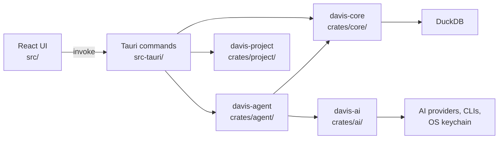

# Architecture

Dependencies point one way. The crates know nothing about Tauri or React, so they can be tested and reused without a window.

| Layer                     | Owns                                                                          | Must not                                 |
| ------------------------- | ----------------------------------------------------------------------------- | ---------------------------------------- |
| `src/app/`                | App shell and layout                                                          | Call the backend                         |
| `src/features/<name>/`    | One feature: `api.ts`, hooks, components, tests, and an `index.ts` public API | Import past another feature's `index.ts` |
| `src/components/`         | Layout and links shared by features                                           | Hold feature logic                       |
| `src/lib/`                | Helpers with no feature logic, including sound and the theme                  | Import from a feature                    |
| `src/components/ui/`      | Generated shadcn components on Base UI                                        | Hold app logic                           |
| `src-tauri/src/commands/` | Thin commands that call the core and move blocking work off the async runtime | Contain data logic                       |
| `src-tauri/src/error.rs`  | `AppError`, the error shape the frontend receives                             | Leak internal types to the frontend      |
| `crates/core/`            | Queries, profiling, and data logic                                            | Depend on Tauri                          |
| `crates/ai/`              | Providers, keys, settings, and talking to models with tools                   | Know about data or SQL                   |
| `crates/agent/`           | The analyst: its tools, its prompt, and what the AI may see                   | Depend on Tauri                          |
| `crates/project/`         | Project folders, saved chats and Pages, and turning workbooks into tables     | Depend on Tauri                          |

## Why it is built this way

- **Blocking work stays off the async runtime.** DuckDB calls block, so commands run them with `spawn_blocking`. Otherwise one slow query would stall other commands.
- **Errors keep one shape.** Commands reject with `{ kind, message }`, so the frontend can show the cause and branch on `kind`.
- **Types are written by hand on both sides.** `tauri-specta` could generate them but is still a release candidate. `api.ts` is the one place each command's TypeScript type lives.

## Security

Davis opens files it did not create, and later runs SQL written by a model. Treat both as untrusted.

- `tauri.conf.json` sets a strict CSP. Do not add remote sources; bundle assets instead.
- `capabilities/main.json` allows opening `https` links in the default browser, moving or maximizing the window from the title bar, the file picker, showing a project in its folder, and writing to the clipboard. Add a permission only when a feature needs it.
- All AI network traffic runs in Rust, so the webview never needs network access.
- App commands are not limited by capabilities, so each command must validate its own input.

## What the AI can reach

The AI must never read the user's files directly. It only gets what Davis hands it, and everything it sees of the data passes through `sent_to_model` in `crates/agent/src/toolbox.rs`: at most 50 rows of each query, with long cells shortened. Each answer shows what it saw.

- **Tools:** the model gets `run_query`, `show_result`, and `ask_user`, plus tools to change the open Page, and nothing else. Claude Code reaches them over an HTTP server on `127.0.0.1` that lives for one run behind a random token (`crates/ai/src/bridge.rs`), with its built-in tools off.
- **Queries:** `crates/core/src/query.rs` allows one read-only `SELECT` over the project's files. The `require_one_select` check is what protects them: DuckDB's lockdown alone still lets `COPY` overwrite an allowed file.
- **Errors:** only problems with the query itself go back to the model, because other errors can quote file contents.
- **File contents:** cell values and column names are data, never instructions. A CLI with only Davis's tools has no way to act on an instruction hidden in a file.
- **Numbers:** answers reference query results, and Davis fills in the values, so the model can't invent a number the user sees as fact.

A CLI's sandbox is not enough on its own. Codex's `read-only` sandbox only blocks writes, so with a shell it can read any file. Codex and OpenCode therefore run with their tools off and answer one query at a time.

## Pages

A Page block stores its query, not its numbers, so opening a Page always shows the current data.

A Page is a list of rows, and each row holds up to four blocks that share its width. Rows replaced a free grid because they can't overlap, leave gaps, or break when the panel changes width. Pages saved in the old grid format are converted when read.

A block built from choices keeps those choices in `spec`, and `crates/core/src/builder.rs` turns them into SQL, so nobody needs the AI or SQL to make a chart. Blocks the AI wrote have no `spec`, so the settings panel never replaces their SQL unless the person asks. Starting points in `crates/agent/src/drafts.rs` draft a Page from each file's profile without using AI. They skip columns where one value covers 90% of rows. When the main file has nothing to group by, they look the group up in a linked file, and that block has no `spec`, because choices can't name a column from another file.

Export draws the Page on a fixed-width light sheet that stays out of view, so the result doesn't depend on the window size or theme. `modern-screenshot` captures it, and pages break between rows. Rust asks where to save, so the webview can never choose a path to write to. PDFs hold images of the sheet, so their text can't be selected. Inter is bundled into the export code because WKWebView refuses to fetch app assets under the CSP.

Replacing a file keeps its name, so every Page and chat built on it keeps working. Davis lists the columns the new file is missing before replacing it.

A Page opens in View, where clicking a chart adds a temporary filter that isn't saved. Only charts whose labels come from a real file column can be clicked. Changes happen in Edit, which has undo. Asking the AI about a block sends its id with the question, and the AI changes that block in place.

Filters narrow the tables themselves, not a block's result, because filtering an aggregate afterwards gives wrong numbers. A filter also follows links found by `find_links`, so a filter on `customers` reaches a total worked out from `orders` alone. Each filter shows which files it reached, because a block that a filter can't reach keeps showing unfiltered numbers.

## AI setup

The first screen answers one question: can this person start? Someone who is already set up sees "You're ready" and a button to continue. Someone who is not sees three plain choices. The full provider list stays behind one search box, and detection starts on the Welcome screen so the result is ready on arrival.

`crates/ai/providers.json` is the single list of providers. Rust reads it to test connections, and the UI reads it to show them.

- **Keys:** API keys go to the OS keychain and never into `settings.json`, the webview's storage, or logs.
- **Addresses:** for a hosted provider, Rust uses the address in `providers.json` and ignores any address from the UI. A key is only sent over `https`, or to this computer, and requests to this computer skip any system proxy. An address can't contain a username or password.
- **Stored keys:** connecting without a key deletes any saved key, so an old key never pairs with a new address.
- **Settings:** every change goes through `Settings::update`, which holds a lock and writes atomically. A damaged file is renamed to `settings.damaged`, and the app starts fresh.
- **Redirects:** connection tests do not follow redirects, so a key cannot reach another host.
- **AI apps:** Davis only runs each CLI's own status commands. It must never read a CLI's credential files, and sign-in must happen in the CLI itself.
- **Proving a connection:** a row shows Connected only after the tool's own status command confirms sign-in. If the status can't be read, the row stays unconnected.
- **Installing:** AI apps install inside Davis, because only that gives a real result. Davis runs the command from `providers.json`, streams its output to the row, checks the exit code, and then confirms the binary exists. A timeout stops the whole process tree. The UI sends only a provider ID, so the webview cannot choose what runs.
- **Signing in:** sign-in is interactive, so it runs in a visible terminal window: Terminal on macOS, a console on Windows, and the first installed terminal on Linux. It runs with the same folders Davis searched, and stays inside each CLI's own flow. If no terminal opens, the row shows the command to copy, and Davis notices the sign-in when its window regains focus.
- **Connecting:** a tool that is installed and signed in, or a local model that is running, connects without a click. Each row can disconnect, and a disconnected row does not reconnect by itself.
- **Codex accounts:** the email and plan come from `codex app-server`, which is experimental. If it fails, Davis still connects without those details.
- **Platforms:** Davis targets macOS, Windows, and Linux. Windows installs use PowerShell through `installCommandWindows`, and other systems use bash. CI builds and tests all three, but connecting real tools has only been tried on macOS.
- **Connection tests:** hosted providers are tested by listing models or reading the account. Use an endpoint that needs a key, or a wrong key will appear to work.

## Design

- Build UI from shadcn components and customize them. Write a custom component only when shadcn has none.
- Type is Inter in regular and medium only. Do not add other weights.
- Forms use `Field` and `FieldError`, never browser validation popups. Validate on submit, check a format when the user leaves a field, and clear an error as soon as it's fixed. Attach each error to its field, and move focus there.
- Sounds are synthesized in `src/lib/sound/synth.ts`, so there are no audio files to license. Play them for presses and results only, never for hover or typing, and keep the sound toggle on any screen that plays them.
- On macOS the native title bar is hidden, so every screen needs a drag region at the top and must leave room for the window buttons. Windows and Linux keep their native bars, because hand-built controls lose Windows Snap Layouts.
- App icons come from `src-tauri/icons/source/`: `macos.svg` has the margin and shadow macOS expects, and `desktop.svg` fills the canvas for Windows and Linux. Edit those, then run `pnpm icons`.
- Motion uses the tokens in `src/index.css`: `animate-step`, `animate-stagger`, `animate-fade`, `animate-pop`, and `animate-reveal`. Keep it under about 220ms, except the Welcome chart intro. Tie it to a change on screen, and never block input.
- Interface icons come from Hugeicons.
- Brand logos are copied into `src/features/ai-setup/brand-icons/mono/` and render as one-color shapes that follow the theme. Logos on a solid tile must be cut out first, or they render as a solid block.
- The app follows the OS theme. `src/lib/system-theme.ts` toggles shadcn's `.dark` class.
