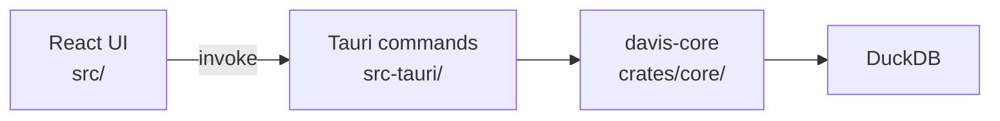

# Architecture

Dependencies point one way. `davis-core` knows nothing about Tauri or React, so it can be tested and reused without a window.

| Layer | Owns | Must not |
|---|---|---|
| `src/app/` | App shell and layout | Call the backend |
| `src/features/<name>/` | One feature: `api.ts`, hooks, components, tests | Import from another feature's internals |
| `src/components/ui/` | Generated shadcn components on Base UI | Hold app logic |
| `src-tauri/src/commands/` | Thin commands that call the core and move blocking work off the async runtime | Contain data logic |
| `src-tauri/src/error.rs` | `AppError`, the error shape the frontend receives | Leak internal types to the frontend |
| `crates/core/` | Queries and data logic | Depend on Tauri |

## Why it is built this way

- **Blocking work stays off the async runtime.** DuckDB calls block, so commands run them with `spawn_blocking`. Otherwise one slow query would stall other commands.
- **Errors keep one shape.** Commands reject with `{ kind, message }`, so the frontend can show the cause and branch on `kind`.
- **Types are written by hand on both sides.** `tauri-specta` could generate them but is still a release candidate. `api.ts` is the one place each command's TypeScript type lives.

## Security

Davis opens files it did not create, and later runs SQL written by a model. Treat both as untrusted.

- `tauri.conf.json` sets a strict CSP. Do not add remote sources; bundle assets instead.
- `capabilities/main.json` grants no Tauri APIs. Add a permission only when a feature needs it.
- App commands are not limited by capabilities, so each command must validate its own input.

## Theme

The app follows the OS theme. `src/lib/system-theme.ts` toggles shadcn's `.dark` class.
